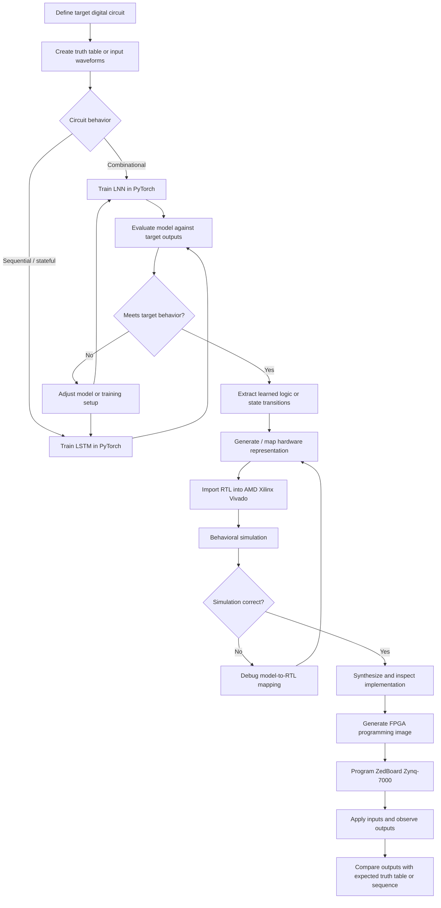
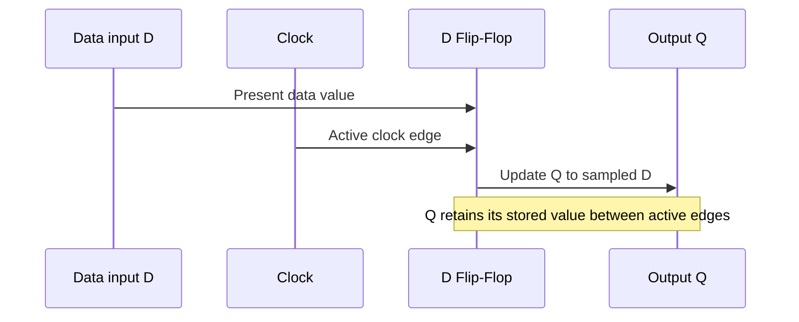
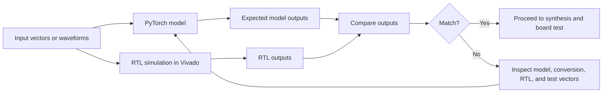

# FPGA Implementation of Logic Circuits Using LNN and LSTM for Self-Adapting Digital Systems

> Research project exploring neural-network-based digital logic design and FPGA implementation using Logic Neural Networks (LNNs), Long Short-Term Memory (LSTM) networks, PyTorch, AMD Xilinx Vivado, and the ZedBoard Zynq-7000 platform.

## Table of Contents

- [1. Project Overview](#1-project-overview)
- [2. What Problem Does This Project Solve?](#2-what-problem-does-this-project-solve)
- [3. Why Use LNN, LSTM, and FPGA?](#3-why-use-lnn-lstm-and-fpga)
- [4. Project Objectives](#4-project-objectives)
- [5. System Architecture](#5-system-architecture)
- [6. End-to-End Execution Flow](#6-end-to-end-execution-flow)
- [7. Components and Their Roles](#7-components-and-their-roles)
- [8. How Each Circuit Works](#8-how-each-circuit-works)
- [9. Tools and Technologies](#9-tools-and-technologies)
- [10. Hardware–Software Co-Simulation](#10-hardwaresoftware-co-simulation)
- [11. Results Reported in the Paper](#11-results-reported-in-the-paper)
- [12. What the Results Mean](#12-what-the-results-mean)
- [13. My Role and Contributions](#13-my-role-and-contributions)
- [14. Limitations and Future Scope](#14-limitations-and-future-scope)
- [15. Repository Structure](#15-repository-structure)
- [16. Reproducibility and Execution Notes](#16-reproducibility-and-execution-notes)
- [17. Conclusion](#17-conclusion)
- [18. Research Paper and References](#18-research-paper-and-references)

---

## 1. Project Overview

This research investigates how neural-network models can be used to represent digital logic circuits and then deploy those circuits on a Field-Programmable Gate Array (FPGA).

The paper combines two model types:

- **Logic Neural Network (LNN):** Used to model combinational logic, where outputs depend on the current inputs.
- **Long Short-Term Memory (LSTM):** Used to model sequential logic, where outputs can depend on the current input and stored state from earlier clock cycles.

The paper studies foundational digital circuits, including NAND and NOR gates, a 1-bit Full Adder, and a D Flip-Flop. The models are trained using PyTorch, and the resulting hardware representations are taken through an AMD Xilinx Vivado simulation and synthesis workflow. The reported target board is the **ZedBoard Zynq-7000 SoC**.

### Project at a glance

| Item | Description |
|---|---|
| Research area | Neural-network-based digital logic design |
| Main models | Logic Neural Network (LNN) and Long Short-Term Memory (LSTM) |
| Combinational examples | NAND, NOR, and 1-bit Full Adder |
| Sequential example | D Flip-Flop |
| Model framework | Python and PyTorch |
| Hardware design and verification | AMD Xilinx Vivado |
| Target platform reported | ZedBoard Zynq-7000 SoC |
| Main purpose | Investigate learning-based logic modeling and FPGA implementation |

## 2. What Problem Does This Project Solve?

### Traditional digital logic design

Digital circuits are commonly designed using Boolean algebra, truth tables, Karnaugh maps, finite-state machines, and hardware description languages. Engineers then simulate, synthesize, and optimize a design for the target hardware.

This is effective, but designing and optimizing more complex circuits can require repeated manual work. A change in requirements may lead to additional design, verification, and optimization effort.

### Research problem

The paper explores whether neural-network models can learn the behavior of digital circuits and help translate that behavior into hardware-oriented representations.

The central challenge is that **combinational and sequential circuits behave differently**:

- A combinational circuit produces an output from the current input values.
- A sequential circuit also depends on stored state and the timing of input or clock transitions.

The paper uses LNNs for combinational logic and LSTMs for sequential behavior, then studies their translation and verification in an FPGA-oriented workflow.

### What this project demonstrates

The work is a proof of concept using small building blocks. It reports implementations of NAND/NOR logic, a Full Adder, and a D Flip-Flop. It does not, by itself, establish that every arbitrary digital design can be automatically generated or that the approach is universally better than conventional synthesis.

## 3. Why Use LNN, LSTM, and FPGA?

### Logic Neural Networks (LNNs)

LNNs model Boolean functions using logic-oriented neuron configurations. In the paper, candidate Boolean functions are represented and the model learns which function best matches the target behavior.

**Why use an LNN?**

- It is suited to combinational logic, such as logic gates and adders.
- Its logic-oriented representation can be easier to interpret than arbitrary continuous neural-network weights.
- Learned behavior can be associated with Boolean gates or hardware lookup structures.

### Long Short-Term Memory (LSTM)

An LSTM is a recurrent neural-network architecture with gates and an internal cell state. These mechanisms let it process sequences and retain information across time steps.

**Why use an LSTM?**

A D Flip-Flop is a sequential element: its output is updated according to input and clock behavior, and its state must be retained between updates. The paper uses an LSTM to model this state-dependent behavior, which a feed-forward combinational model does not naturally represent.

### Field-Programmable Gate Array (FPGA)

An FPGA is reconfigurable hardware that can implement digital logic after the design is synthesized and programmed.

**Why use an FPGA?**

- To test whether learned logic can be represented as hardware.
- To simulate and verify digital behavior before programming the board.
- To examine implementation factors such as lookup-table (LUT) usage and reported power.
- To demonstrate execution on a physical development board.

### How the pieces fit together

| Technology | Role in the project |
|---|---|
| Python | Model development and experiment orchestration |
| PyTorch | Neural-network model training and evaluation |
| LNN | Modeling combinational Boolean behavior |
| LSTM | Modeling state-dependent sequential behavior |
| Verilog/VHDL or other generated RTL | Hardware representation described in the paper's synthesis flow |
| Vivado | RTL simulation, synthesis, and FPGA implementation workflow |
| ZedBoard Zynq-7000 | Target FPGA development platform |
| Switches and LEDs | Physical input and output interaction described in the paper |

**Important implementation note:** The paper describes automatic VHDL export for LNN and Verilog export for LSTM in its comparison table. Its workflow section also discusses synthesizable Verilog and ROM/register structures. Confirm the actual generated HDL files before documenting a specific implementation path as reproducible.

## 4. Project Objectives

1. Investigate LNNs for learning combinational digital logic.
2. Investigate LSTMs for modeling sequential logic behavior.
3. Apply the models to small circuits such as NAND/NOR, a Full Adder, and a D Flip-Flop.
4. Connect model training and evaluation with an FPGA-oriented hardware workflow.
5. Use simulation and hardware tests to check whether the generated circuit behavior matches the target logic.
6. Compare reported accuracy, evaluation time, lookup-table usage, and power figures for the tested cases.

## 5. System Architecture

The following diagram summarizes the end-to-end workflow described in the paper. It is a conceptual overview; the exact intermediate scripts and file formats should be confirmed from the implementation files.



### Reading the diagram

1. **Define the circuit:** Decide which digital behavior must be reproduced.
2. **Prepare examples:** Use a truth table for combinational logic or time-ordered waveforms for sequential logic.
3. **Choose the model:** The paper uses LNN for combinational behavior and LSTM for sequential behavior.
4. **Train and evaluate:** Compare predictions with expected outputs.
5. **Map to hardware:** Extract the learned behavior and represent it using hardware logic, lookup structures, or sequential registers.
6. **Verify in Vivado:** Run simulation and synthesis checks.
7. **Deploy to the board:** Program the FPGA and check real input/output behavior.

The paper reports a 100% accuracy milestone for its evaluated circuit cases. The architecture-comparison table also lists final training accuracies near 97%; these are different reported measures and should not be treated as the same metric.

## 6. End-to-End Execution Flow

### Step 1 — Define the required behavior

Specify the circuit and its expected behavior.

For a 1-bit Full Adder, the inputs are `A`, `B`, and `Cin`. The expected outputs are `Sum` and `Cout`.

For a D Flip-Flop, the behavior is sequential: the stored output updates in response to the input and the relevant clock edge.

### Step 2 — Prepare training and test examples

For combinational circuits, enumerate the possible input combinations and their expected outputs in a truth table. For example, a two-input gate has four possible binary input combinations.

For sequential circuits, use ordered input and clock samples so that the relationship between current inputs, clock transitions, and state can be evaluated.

The paper describes training from truth tables or waveform data. The exact dataset format, split strategy, and preprocessing scripts are not specified in the paper excerpt; consult the project source files for those details.

### Step 3 — Train the model

- Use an LNN to learn combinational logic behavior.
- Use an LSTM to learn state-dependent sequential behavior.
- Evaluate the learned output against the target output.

The paper's LNN description represents candidate two-input Boolean functions and learns a selection over them. The LSTM uses recurrent state and gating to retain temporal information.

### Step 4 — Convert learned behavior into a hardware representation

The paper describes extracting trained weights and biases after the target behavior has been learned. For LNNs, learned logic is mapped to equivalent Boolean gates or lookup primitives. For LSTMs, the described pipeline maps state transitions into hardware structures such as ROM and sequential registers.

This is the bridge between software training and digital hardware implementation. Exact scripts, conversion utilities, and HDL source code should be included in the repository if they are available.

### Step 5 — Simulate and synthesize in Vivado

Import the hardware description into Vivado and perform the applicable simulation and synthesis stages.

- **Behavioral simulation:** Checks whether the logic produces the expected outputs.
- **Synthesis:** Converts the RTL description into a hardware implementation for the target FPGA.
- **Implementation and programming-file generation:** Prepare the design for the target board.

A correct software prediction alone does not prove that the generated hardware is correct. The RTL must also be verified.

### Step 6 — Test on the physical FPGA board

The paper describes using switches as real-time stimuli and onboard LEDs to observe outputs on the ZedBoard Zynq-7000.

For combinational circuits, apply input combinations and compare `Sum`/`Carry` or gate outputs with the expected truth table.

For the D Flip-Flop, test clocked input changes and verify that the output follows the specified state-update behavior.

### Step 7 — Evaluate the result

Record the results for each circuit and model:

- Functional correctness and test accuracy.
- Software evaluation time.
- FPGA resource usage, including LUTs where reported.
- Power values as reported by the experiment.
- Any observed difference between simulation and physical board behavior.

Do not assume that all measurements use the same methodology. In particular, the paper labels evaluation time as per-sample software evaluation time for combinational circuits and a multi-cycle sampling interval for the D Flip-Flop.

## 7. Components and Their Roles

### 7.1 LNN model

The LNN models Boolean logic. Its neurons select among candidate logic functions, making it appropriate for combinational circuits.

**Input:** Binary input combinations or truth-table examples.  
**Processing:** Train the model to select logic behavior that matches the target truth table.  
**Output:** A learned logic representation that can be mapped to Boolean gates or lookup primitives.

### 7.2 LSTM model

The LSTM processes ordered samples and retains internal state through recurrent connections and gating mechanisms.

**Input:** Time-ordered input and clock/state-related samples.  
**Processing:** Learn a state-dependent input/output relationship.  
**Output:** A model of sequential behavior that the paper maps to hardware structures.

### 7.3 Full Adder

A Full Adder adds three one-bit inputs: `A`, `B`, and carry-in `Cin`. It produces a sum bit and carry-out bit.

- `Sum = A XOR B XOR Cin`
- `Cout = (A AND B) OR (Cin AND (A XOR B))`

The paper reports synthesizing and verifying the Full Adder using both LNN and LSTM approaches.

### 7.4 D Flip-Flop

A D Flip-Flop stores one bit of state. On its active clock edge, its output `Q` updates to the value of `D`; between active edges, the stored output remains unchanged, subject to the circuit's specified reset and timing behavior.

The paper uses an LSTM for the D Flip-Flop because sequential logic requires state and temporal behavior. The paper reports an LSTM-based implementation; it does not report an LNN implementation result for the D Flip-Flop in its performance table.

### 7.5 Vivado

Vivado is used in the reported workflow for RTL simulation, synthesis, and FPGA deployment. Simulation helps check the behavior before programming the board.

### 7.6 ZedBoard Zynq-7000

The target development platform used in the paper's reported physical implementation. The paper describes switches for input stimuli and onboard LEDs for output observation.

## 8. How Each Circuit Works

### 8.1 Two-input logic gate truth table

A two-input gate has four input combinations.

| A | B | NAND | NOR |
|---:|---:|---:|---:|
| 0 | 0 | 1 | 1 |
| 0 | 1 | 1 | 0 |
| 1 | 0 | 1 | 0 |
| 1 | 1 | 0 | 0 |

**Purpose of this test:** Confirm that the learned logic matches the expected Boolean function for every input combination.

### 8.2 Full Adder truth table

| A | B | Cin | Sum | Cout |
|---:|---:|---:|---:|---:|
| 0 | 0 | 0 | 0 | 0 |
| 0 | 0 | 1 | 1 | 0 |
| 0 | 1 | 0 | 1 | 0 |
| 0 | 1 | 1 | 0 | 1 |
| 1 | 0 | 0 | 1 | 0 |
| 1 | 0 | 1 | 0 | 1 |
| 1 | 1 | 0 | 0 | 1 |
| 1 | 1 | 1 | 1 | 1 |

**Purpose of this test:** Verify both outputs for all eight possible combinations of the three input bits.

### 8.3 D Flip-Flop timing concept



This is a conceptual timing sequence, not a measured waveform. Use the paper's Vivado waveform or your own simulation output for a timing figure in the repository.

## 9. Tools and Technologies

| Tool / technology | Purpose in the research |
|---|---|
| Python | Model development and experiment workflow |
| PyTorch | LNN/LSTM training and evaluation |
| AMD Xilinx Vivado | RTL simulation, synthesis, and FPGA workflow |
| Verilog / VHDL | Hardware description formats discussed in the paper |
| ZedBoard Zynq-7000 | FPGA platform used for reported board implementation |
| NAND, NOR, Full Adder, D Flip-Flop | Circuit examples evaluated in the study |

Only list additional packages, board files, scripts, or tools if they were actually used in your implementation.

## 10. Hardware–Software Co-Simulation

Hardware–software co-simulation links the learned model with a hardware implementation so that behavior can be checked across both environments.



The comparison should use matching input vectors and clearly defined timing/state assumptions. For sequential logic, align clock cycles and state initialization; comparing only unordered input/output pairs may be insufficient.

## 11. Results Reported in the Paper

The following figures are transcribed from the paper's performance table. They should be understood as **paper-reported results**, not independently reproduced measurements from this GitHub repository.

| Circuit | Model | Reported accuracy | Evaluation time | LUTs | Reported power |
|---|---|---:|---:|---:|---:|
| NAND | LNN | 100% | 1600 µs | 1 | 0.823 W |
| NAND | LSTM | 100% | 297.16 µs | 1 | 0.817 W |
| Full Adder | LNN | 100% | 1173.41 µs | 1 | 2.896 W |
| Full Adder | LSTM | 100% | 302.89 µs | 1 | 2.893 W |
| D Flip-Flop | LNN | Not reported | Not reported | Not reported | Not reported |
| D Flip-Flop | LSTM | 100% | 212 ms | 5 | 1.345 W |

**Measurement note:** The paper says the evaluation time is per-sample software evaluation time for combinational gates and a multi-cycle sampling interval in milliseconds for D Flip-Flop state evaluation. These values should not be compared as if they were the same kind of timing measurement.

The paper's model-comparison table separately reports final training accuracy of 96.98% for LNN and 96.96% for LSTM. The circuit performance table reports 100% accuracy for the listed evaluated circuit cases. These are distinct reported results; the README preserves that distinction rather than combining them into one claim.

## 12. What the Results Mean

### Functional correctness

The paper reports 100% accuracy for the listed NAND, Full Adder, and LSTM-based D Flip-Flop evaluations. It also describes Vivado waveform checks and board-level verification. These results support the proof of concept for the tested circuits; they do not establish correctness for all possible circuits.

### Evaluation time

For the combinational cases shown, the reported LSTM evaluation times are lower than the reported LNN times. The D Flip-Flop uses a different time scale and evaluation definition, so it should be interpreted separately.

### Hardware resources and power

The paper reports LUT counts and power values for the listed cases. These values depend on the design, target platform, implementation settings, and measurement or estimation methodology. The paper's table alone does not provide enough detail to generalize the figures to other FPGA boards or designs.

### Practical interpretation

The research suggests that neural models can be used to represent and test small combinational and sequential circuits in an FPGA-oriented workflow. Scaling to larger designs requires further investigation of architecture, resource utilization, state representation, timing, and automated mapping.

## 13. My Role and Contributions

This is a team research paper. **Edit this section so that it accurately describes your personal work.** The paper's author list does not specify each author's individual responsibilities, so this README must not assign work to an individual without confirmation.

Use the following structure and replace the placeholders with your actual contribution:

- **Research and problem understanding:** [Describe the research questions, background study, or literature review you personally completed.]
- **Modeling and implementation:** [Specify whether you worked on LNN, LSTM, truth tables, training code, RTL generation, or another component.]
- **Simulation and verification:** [Describe the Vivado simulations, test cases, waveform checks, or board tests you personally performed.]
- **Results and analysis:** [Explain which measurements, comparisons, or findings you analyzed.]
- **Documentation and presentation:** [Describe the sections, diagrams, experiments, or presentations you prepared.]

### How to write a strong contribution statement

For each contribution, explain:

1. **What I did:** The specific task you personally completed.
2. **How I did it:** The tools, method, and process you used.
3. **Why it mattered:** How the task supported the project objective.
4. **Evidence:** The source file, experiment, diagram, result, or section that demonstrates the work.

Do not claim that you wrote the model-training code, generated RTL, programmed the FPGA, or performed measurements unless you personally did those tasks or can accurately explain your role in them.

## 14. Limitations and Future Scope

The paper identifies several scaling challenges:

- Larger Boolean functions can increase LNN configuration and training complexity.
- More complex datapaths may need modular or hierarchical decomposition rather than one large learned truth table.
- Scaling LSTM models to larger finite-state machines requires careful handling of recurrent state and hardware resources.
- State encoding approaches, including one-hot and Gray encoding, are discussed as possible ways to simplify decoding logic.
- Future work includes exploring automated hierarchical partitioning for more complex units such as multi-bit arithmetic logic units (ALUs) and controllers.

These are future directions discussed in the paper, not features that should be described as already implemented.

## 15. Repository Structure

A clear repository structure could look like this. Keep only files that actually exist in your project.

```text
fpga-neural-logic/
├── README.md
├── paper/
│   └── research-paper.pdf
├── diagrams/
│   ├── system-architecture.png
│   └── workflow.png
├── src/
│   ├── lnn/
│   ├── lstm/
│   └── utilities/
├── rtl/
│   ├── combinational/
│   └── sequential/
├── testbench/
├── results/
│   ├── simulation/
│   └── measurements/
└── LICENSE
```

If you have only the research paper and no source code, do not create empty folders to imply that code or test results are available. You can begin with `README.md`, `paper/`, and `diagrams/`, then add implementation files as they become available.

## 16. Reproducibility and Execution Notes

The paper describes the research workflow but does not provide enough information in the paper alone to reconstruct every command and script. To make this GitHub project reproducible, add the following if available:

- Python and PyTorch versions.
- Dependency file such as `requirements.txt`.
- Model training and evaluation scripts.
- Exact input truth tables or waveform datasets.
- Model configuration and training parameters.
- Model-to-RTL export or mapping scripts.
- Generated Verilog/VHDL source files.
- Vivado project files and testbenches.
- FPGA board constraints and programming files, where redistribution is permitted.
- Simulation waveforms, synthesis reports, resource reports, and measurement methodology.

### Suggested execution documentation

Once the real scripts are available, replace this outline with verified commands:

```bash
# 1. Create and activate a Python environment
# 2. Install the dependencies listed by the project
# 3. Run the selected LNN or LSTM training script
# 4. Evaluate the trained model
# 5. Export or map the model to RTL
# 6. Open the RTL project in Vivado
# 7. Run simulation and synthesis
# 8. Generate the FPGA programming file and test on the board
```

These are workflow stages, not executable commands. Do not present them as runnable until the actual scripts, filenames, and Vivado steps are documented.

## 17. Conclusion

This research explores a neural-network-based approach to digital logic design using LNNs for combinational behavior and LSTMs for sequential behavior. The paper reports experiments involving NAND/NOR logic, a Full Adder, and a D Flip-Flop, with a workflow spanning PyTorch model training, hardware representation, Vivado simulation and synthesis, and deployment on a ZedBoard Zynq-7000.

The central contribution is the investigation of a path from learned logic behavior to FPGA implementation. The reported circuit results provide a proof of concept for the selected building blocks, while larger designs remain an area for future work.

## 18. Research Paper and References

**Paper title:** *FPGA Implementation of Logic Circuits Using LNN and LSTM for Self-Adapting Digital Systems*

**Authors listed in the paper:** Shamitha Chowdary Paruchuru, Jahnavi Chopparapu, Venkata Nandini Thella, Sri Lekha Ganpisetti, VedaPrakash Reddy Syamala, and Sarada Musala.

**Affiliation:** Department of Electronics and Communication Engineering, Vignan’s Foundation for Science, Technology and Research, Guntur, India.

Add the publication venue, year, DOI, and public paper URL here if available. The supplied paper copy does not provide a clearly identifiable publication venue, year, or DOI in the extracted front matter, so those details should be verified rather than guessed.

The research paper contains the bibliography for the related work cited in this README. Preserve the original references from the paper when publishing the full citation list.

---

## Before publishing

- [ ] Replace the personal-contribution placeholders with your actual work.
- [ ] Add the paper PDF if you are permitted to share it.
- [ ] Add real source code and reproducible commands if available.
- [ ] Upload diagrams and simulation screenshots that you have permission to publish.
- [ ] Verify publication metadata and the interpretation of all reported metrics.
- [ ] Ensure every result is labeled as paper-reported or independently reproduced.
