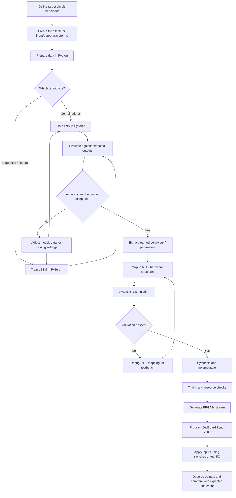
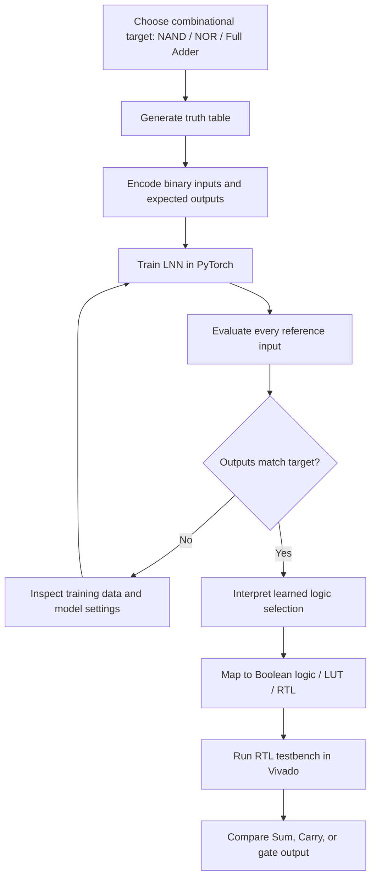
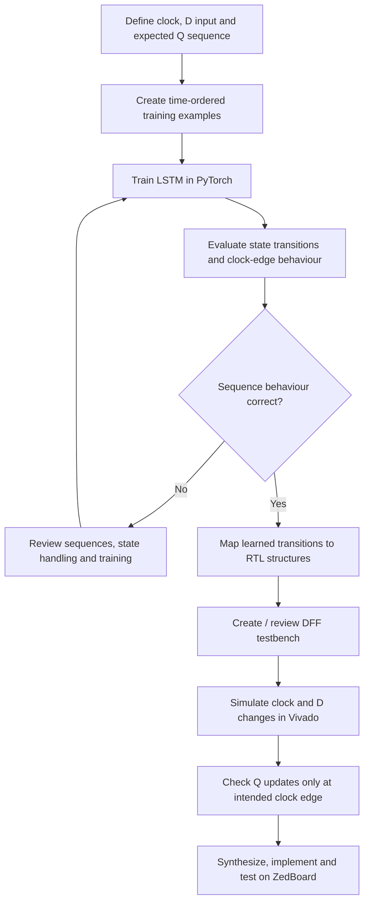
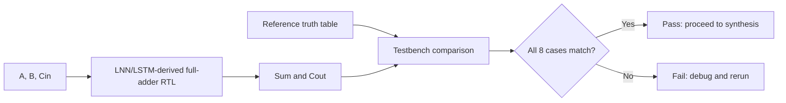
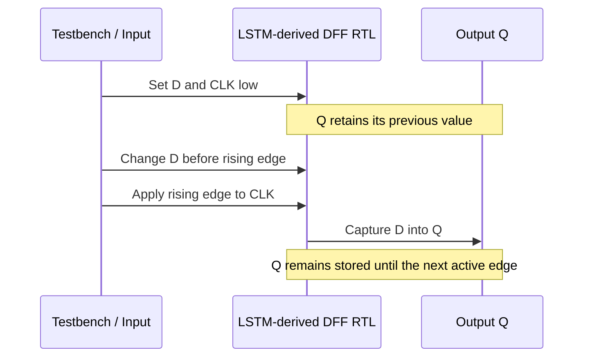
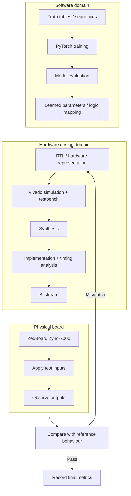

# FPGA Implementation of Logic Circuits Using LNN and LSTM

<p align="center">
  <strong>AI-assisted digital logic design · PyTorch · Verilog/RTL · AMD Xilinx Vivado · ZedBoard Zynq-7000</strong>
</p>

> **Project overview:** This project studies how neural networks can learn digital-circuit behaviour and how the learned behaviour can be translated into hardware logic for an FPGA. Logic Neural Networks (LNNs) are used for combinational logic, while Long Short-Term Memory (LSTM) networks are used for sequential behaviour such as a D flip-flop.

---

## Table of Contents

- [1. What is this project?](#1-what-is-this-project)
- [2. Why did we choose this project?](#2-why-did-we-choose-this-project)
- [3. Problem statement](#3-problem-statement)
- [4. Project objectives](#4-project-objectives)
- [5. Technologies and hardware](#5-technologies-and-hardware)
- [6. Important concepts](#6-important-concepts)
- [7. Complete system architecture](#7-complete-system-architecture)
- [8. End-to-end execution flow](#8-end-to-end-execution-flow)
- [9. How the combinational path works: LNN](#9-how-the-combinational-path-works-lnn)
- [10. How the sequential path works: LSTM](#10-how-the-sequential-path-works-lstm)
- [11. Full-adder example](#11-full-adder-example)
- [12. D flip-flop example](#12-d-flip-flop-example)
- [13. Software-to-hardware co-simulation](#13-software-to-hardware-co-simulation)
- [14. Flowcharts](#14-flowcharts)
- [15. How to execute the project](#15-how-to-execute-the-project)
- [16. Verification and testing](#16-verification-and-testing)
- [17. Results reported in the paper](#17-results-reported-in-the-paper)
- [18. Limitations and future work](#18-limitations-and-future-work)
- [19. Suggested repository structure](#19-suggested-repository-structure)
- [20. My role and contributions](#20-my-role-and-contributions)
- [21. References and acknowledgements](#21-references-and-acknowledgements)

---

## 1. What is this project?

Traditional digital circuits are normally designed using Boolean expressions, logic gates, state tables, and hardware description languages. This project explores a different route: **train a neural model on the expected input/output behaviour, convert the learned behaviour into a hardware representation, and validate it on an FPGA**.

The work combines two model types:

| Model | Purpose | Examples in this project |
|---|---|---|
| **Logic Neural Network (LNN)** | Learns combinational input-to-output logic, where outputs depend on the current inputs | NAND/NOR logic and a 1-bit full adder |
| **Long Short-Term Memory (LSTM)** | Learns sequence-dependent behaviour that depends on previous state as well as current input | D flip-flop behaviour |

The trained model is not the final FPGA circuit by itself. The model is trained and evaluated in Python/PyTorch; its logic behaviour is then represented in hardware description/RTL, simulated and synthesized in Vivado, and deployed to the ZedBoard Zynq-7000 platform.

### Project scope

- Model combinational logic using LNN and LSTM approaches.
- Model sequential D flip-flop behaviour using LSTM.
- Compare model accuracy and selected implementation metrics.
- Verify the generated/specified hardware behaviour in Vivado.
- Deploy the design to a ZedBoard and check inputs and outputs on physical hardware.

---

## 2. Why did we choose this project?

### The problem with a fully manual workflow

For a conventional circuit, an engineer derives Boolean equations or a state machine, writes RTL, simulates it, synthesizes it, and iterates to meet timing and resource constraints. For larger designs, manual logic optimisation and repeated verification can take considerable effort.

The project investigates whether a learning-based workflow can reduce some of that manual logic-construction effort.

### Why combine LNN and LSTM?

**LNN for combinational logic:** A combinational circuit has no memory of earlier inputs. Its output is determined by the current input combination. LNNs represent Boolean functions using learnable selections among logic-function primitives, which makes their learned behaviour interpretable in terms of logic operations.

**LSTM for sequential logic:** A sequential circuit must preserve state. Its output depends on clocked events and the history of inputs. LSTM networks have a cell state and gating mechanisms that model information being retained, updated, or exposed over time. The project uses this temporal modelling capability for D flip-flop behaviour.

### Why an FPGA?

An FPGA is reconfigurable hardware. A design can be synthesized into the FPGA's programmable logic and tested on a physical board. This gives the project a way to move beyond Python-only predictions and check whether the hardware implementation behaves as expected.

### Why co-simulation?

Python testing alone does not prove that the translated RTL works correctly. Hardware simulation and board testing help check that the hardware representation matches the intended truth table or waveform behaviour before and after deployment.

**In short:** the motivation is to explore a repeatable path from *behavioural examples → trained model → hardware representation → simulation → FPGA verification*.

---

## 3. Problem statement

Can neural networks learn the behaviour of basic combinational and sequential digital circuits and be used as part of a software-to-hardware workflow for FPGA implementation?

The project examines this question using NAND logic, a 1-bit full adder, and a D flip-flop. It compares LNN and LSTM approaches where applicable and uses Python/PyTorch, RTL, Vivado, and a ZedBoard Zynq-7000.

---

## 4. Project objectives

1. Train LNN/LSTM models using digital logic truth tables or sequence/waveform examples.
2. Evaluate learned outputs against expected logic behaviour.
3. Investigate the use of LNNs for combinational circuits.
4. Investigate the use of LSTMs for sequential D flip-flop behaviour.
5. Translate the learned behaviour into hardware representations/RTL.
6. Simulate and synthesize the design in AMD Xilinx Vivado.
7. Deploy the FPGA configuration to a ZedBoard Zynq-7000.
8. Evaluate functional correctness and the reported latency, LUT utilisation, and power metrics.
9. Identify practical limitations when scaling to more complex circuits.

---

## 5. Technologies and hardware

| Technology | Role in the workflow |
|---|---|
| **Python** | Training scripts, data preparation, evaluation, and experiments |
| **PyTorch** | Defining and training LNN/LSTM models |
| **Verilog / RTL** | Describing the hardware implementation that Vivado can simulate and synthesize |
| **AMD Xilinx Vivado** | RTL simulation, synthesis, implementation, timing checks, and bitstream generation |
| **ZedBoard Zynq-7000** | Physical FPGA deployment and board-level verification |
| **Switches / LEDs / I/O** | Provide test inputs and show or measure outputs where the board design supports them |

> **Important reproducibility note:** The paper describes the workflow and reports results, but the commands below are a practical execution checklist. Use the actual filenames, HDL export scripts, board constraints, and Vivado project files present in your repository. Do not assume that a generated RTL exporter or a particular script name exists unless you have added it.

---

## 6. Important concepts

### 6.1 Combinational logic

A combinational circuit produces outputs from the current inputs only. It has no stored state.

Examples:
- NAND/NOR gates
- Adders
- Encoders and decoders

For a 1-bit full adder, inputs are `A`, `B`, and `Cin`; outputs are `Sum` and `Cout`.

### 6.2 Sequential logic

A sequential circuit stores state. Its next output/state depends on a current input and the previous state, usually under clock control.

Example:
- A D flip-flop captures input `D` at the rising edge of `CLK` and holds the stored value until the next active edge.

### 6.3 Logic Neural Network (LNN)

The paper describes an LNN neuron as selecting among possible Boolean functions. During training, learnable parameters change the preference for those functions. The intended result is a model that represents a logic operation and can be mapped to hardware logic primitives.

### 6.4 Long Short-Term Memory (LSTM)

An LSTM uses:
- **Forget gate:** controls what prior cell-state information is retained.
- **Input gate:** controls how new information updates the cell state.
- **Cell state:** carries information through time steps.
- **Output gate:** controls the exposed hidden-state output.

This stateful structure is why the project explores LSTM for D flip-flop behaviour rather than relying on a feed-forward LNN alone.

### 6.5 FPGA, LUT, RTL and bitstream

- **FPGA:** reconfigurable digital hardware.
- **LUT (Look-Up Table):** a programmable logic resource used to implement Boolean functions.
- **RTL (Register-Transfer Level):** a hardware description of logic and state transitions.
- **Synthesis:** converts RTL into FPGA resources.
- **Implementation / place and route:** maps the design onto the device and checks timing constraints.
- **Bitstream:** the configuration file used to program the FPGA fabric.

---

## 7. Complete system architecture

The architecture has two model paths that converge at hardware validation.



### Architecture explanation

1. **Define behaviour:** decide which circuit is being modelled and specify the expected output for each input or clocked sequence.
2. **Train the suitable model:** use LNN for combinational logic and LSTM for sequential behaviour.
3. **Validate the model:** compare predictions with the reference outputs.
4. **Map to hardware:** convert the learned behaviour to a hardware representation such as gates, lookup logic, registers, or RTL.
5. **Verify in Vivado:** simulate the RTL before committing to board programming.
6. **Implement and deploy:** synthesize, place and route, generate the bitstream, and program the FPGA.
7. **Check the board:** apply known inputs and verify the observed outputs.

---

## 8. End-to-end execution flow

This is the project flow from a developer's perspective.

```mermaid
flowchart LR
    A["1. Specify circuit"] --> B["2. Build reference data"]
    B --> C["3. Train model"]
    C --> D["4. Test model"]
    D --> E["5. Export/map hardware"]
    E --> F["6. Simulate RTL"]
    F --> G["7. Synthesize"]
    G --> H["8. Implement and check timing"]
    H --> I["9. Generate bitstream"]
    I --> J["10. Program FPGA"]
    J --> K["11. Verify physical outputs"]
    K --> L["12. Record accuracy, LUTs, latency and power"]
```



### What happens at each stage?

| Stage | Input | Action | Output / evidence |
|---|---|---|---|
| Specify circuit | Circuit requirements | Define target behaviour | Circuit definition |
| Build reference data | Truth table or waveform specification | Prepare input/output examples | Training and test examples |
| Train | Prepared examples | Optimise LNN/LSTM parameters | Trained model |
| Test model | Held-out/reference examples | Compare predicted and expected outputs | Accuracy and mismatch report |
| Map hardware | Validated model | Convert learned behaviour to hardware structures/RTL | RTL or equivalent hardware representation |
| Simulate RTL | RTL and testbench | Test input combinations and clock sequences | Waveforms and pass/fail evidence |
| Synthesize | Passing RTL | Map logic to FPGA primitives | Resource report |
| Implement | Synthesized design and constraints | Place and route, timing analysis | Implementation/timing reports |
| Generate bitstream | Implemented design | Create FPGA configuration | Bitstream file |
| Board test | Bitstream and test inputs | Program board and check outputs | Board verification evidence |
| Evaluate | Logs and reports | Compare metrics | Results table and conclusions |

---

## 9. How the combinational path works: LNN

### Example: learning a two-input logic function

For a two-input Boolean function, the reference data has four possible input combinations: `(0,0)`, `(0,1)`, `(1,0)`, and `(1,1)`. The target circuit provides the expected output for each combination.

The LNN training process learns which Boolean-function primitives best represent the target behaviour. The trained model is evaluated against the reference truth table. If the learned behaviour is accepted, it is mapped to hardware logic and tested in Vivado.



### Why use an LNN here?

The target is a static Boolean relationship. LNNs are designed to represent logic functions using logic-oriented primitives, so the learned result can be interpreted and mapped to digital logic more directly than a generic neural network.

### Full-adder equations

For inputs `A`, `B`, and carry-in `Cin`:

```text
Sum  = A XOR B XOR Cin
Cout = (A AND B) OR (Cin AND (A XOR B))
```

A full adder has eight possible input combinations. Verification should cover all eight combinations and compare both `Sum` and `Cout` with the reference truth table.

---

## 10. How the sequential path works: LSTM

### Why is sequential behaviour different?

A D flip-flop stores one bit. Its output is not simply a function of the current `D` input at every instant: the value is captured at the active clock edge and then held. A model must therefore learn a sequence/state relationship rather than a static truth table alone.

The project uses an LSTM to model this temporal behaviour.



### D flip-flop behaviour to verify

- When the active rising clock edge occurs, `Q` takes the value of `D`.
- Between active clock edges, `Q` retains its previous value.
- `Q̅`, if implemented, is the inverse of `Q`.

A suitable testbench must vary `D` both before and between clock edges. Checking only a few static values is insufficient to establish correct sequential behaviour.

---

## 11. Full-adder example

A 1-bit full adder adds three one-bit inputs (`A`, `B`, `Cin`) and returns a one-bit sum and carry-out.

### Truth table

| A | B | Cin | Sum | Cout |
|---:|---:|---:|---:|---:|
| 0 | 0 | 0 | 0 | 0 |
| 0 | 0 | 1 | 1 | 0 |
| 0 | 1 | 0 | 1 | 0 |
| 0 | 1 | 1 | 0 | 1 |
| 1 | 0 | 0 | 1 | 0 |
| 1 | 0 | 1 | 0 | 1 |
| 1 | 1 | 0 | 0 | 1 |
| 1 | 1 | 1 | 1 | 1 |

### Verification flow



The paper reports functional simulation of the full adder and implementation on the ZedBoard. Use actual Vivado waveforms and board photos in this repository if available; do not substitute illustrative images for evidence of your own run.

---

## 12. D flip-flop example

A D flip-flop stores one bit and updates its output on the rising edge of the clock.

| Clock event | D | Next Q |
|---|---:|---:|
| Rising edge | 0 | 0 |
| Rising edge | 1 | 1 |
| No active edge | Either | Hold previous Q |



For a proper test, include transitions where `D` changes while the clock is low, then apply a rising edge and verify that `Q` changes only at that edge.

---

## 13. Software-to-hardware co-simulation

Co-simulation connects the software model to the hardware implementation.

### Software validation

Python/PyTorch is used to prepare data, train the model, and compare model predictions against expected outputs. This catches data or model issues before hardware implementation.

### RTL validation

The hardware representation is tested in Vivado with a testbench. Combinational circuits are checked across all input combinations. Sequential circuits are checked across time-ordered input and clock sequences.

### FPGA validation

After simulation passes, Vivado synthesizes and implements the design, checks timing/resource reports, and generates a bitstream. The bitstream is programmed onto the ZedBoard. Physical inputs and outputs are then compared with expected behaviour.



### What should be saved in GitHub?

- Training and evaluation scripts (if available).
- Truth tables or sequence data.
- RTL/Verilog files and testbenches.
- Vivado simulation waveforms.
- Synthesis and timing reports.
- Board photographs or screenshots from your actual implementation.
- A results table showing the test conditions and measurement source.

---

## 14. Flowcharts

GitHub can render Mermaid diagrams inside Markdown files. The diagrams in this README are Mermaid source blocks, so they remain editable text and are rendered by GitHub where Mermaid is supported.

### Flowchart index

1. **Complete architecture:** Section 7.
2. **End-to-end execution:** Section 8.
3. **LNN combinational path:** Section 9.
4. **LSTM sequential path:** Section 10.
5. **Full-adder validation:** Section 11.
6. **D flip-flop timing sequence:** Section 12.
7. **Co-simulation and deployment:** Section 13.

If a diagram does not render in a previewer, open the README directly on GitHub. For a static diagram image, export the flowchart to PNG/SVG and place it in a repository folder such as `docs/images/`, then embed it with a relative Markdown path.

---

## 15. How to execute the project

The exact commands depend on the source code and Vivado project files included in the repository. The paper describes the stages below but does not provide a universally applicable command line for every local setup. Replace example filenames with the real filenames in your repository.

### 15.1 Prepare the environment

1. Install Python and create a virtual environment.
2. Install the package versions required by the training code, including PyTorch if the scripts use it.
3. Install AMD Xilinx Vivado compatible with the target Zynq-7000 board.
4. Connect and configure the ZedBoard only when you are ready for hardware testing.
5. Keep the training scripts, RTL, testbenches, board constraints, and Vivado project organised in the repository.

Example environment setup:

```bash
python -m venv .venv
```

Activate the environment:

**Windows PowerShell**
```powershell
.\.venv\Scripts\Activate.ps1
```

**Linux / macOS**
```bash
source .venv/bin/activate
```

Install dependencies only after creating a `requirements.txt` that matches the actual project:

```bash
python -m pip install --upgrade pip
python -m pip install -r requirements.txt
```

### 15.2 Run the Python model

Run the training script that actually exists in your repository. For example, if your file is named `train_lnn.py`:

```bash
python train_lnn.py
```

For an LSTM training script named `train_lstm.py`:

```bash
python train_lstm.py
```

These are **example filenames**, not filenames guaranteed by the paper. The training stage should:
1. Load or generate the truth-table / sequence examples.
2. Build the chosen LNN or LSTM.
3. Train the model.
4. Evaluate predictions against expected outputs.
5. Save the model or export the learned logic/parameters, if the project code implements that step.

### 15.3 Inspect the exported hardware

Confirm that the hardware mapping/export stage has produced the RTL expected by your Vivado project. The paper describes a translation from learned parameters to hardware logic/RTL; the exact export implementation must be documented from the source code that you actually use.

Do not report the model as deployed to the FPGA merely because Python training succeeded. RTL export, simulation, synthesis, implementation, bitstream generation, and board testing are separate steps.

### 15.4 Simulate and synthesize in Vivado

1. Open the existing Vivado project, or create one for the correct ZedBoard Zynq-7000 target.
2. Add the RTL source files.
3. Add the appropriate testbench files as simulation sources.
4. Run behavioral simulation.
5. Check all full-adder truth-table cases and D flip-flop clock/state transitions.
6. Fix any mismatches before continuing.
7. Run synthesis and implementation.
8. Review LUT usage, timing, and power reports.
9. Generate the bitstream after the design passes the required checks.

### 15.5 Program and test the ZedBoard

1. Connect the board and open the Vivado hardware/programming flow.
2. Program the generated bitstream.
3. Apply the input combinations using switches or the configured I/O.
4. Observe the output LEDs or other mapped output interface.
5. Compare the observed outputs with the reference truth table or expected sequential behaviour.
6. Save evidence of the test and record the board configuration used.

### 15.6 Record the run

For each experiment, record:
- Circuit and model type
- Model accuracy and test cases
- RTL simulation pass/fail
- Target FPGA/board
- LUT/resource usage
- Timing information
- Power estimate or measurement and its source
- Whether the result came from software evaluation, Vivado reports, or physical board testing

---

## 16. Verification and testing

### Combinational verification checklist

- [ ] Test every input combination for the selected two-input gate.
- [ ] Test all 8 full-adder input combinations.
- [ ] Compare every output bit against the reference truth table.
- [ ] Review simulation waveforms for unexpected transitions.
- [ ] Confirm the synthesized design matches the intended I/O mapping.

### Sequential verification checklist

- [ ] Initialise the clock and state as required by the design.
- [ ] Change `D` before and between active clock edges.
- [ ] Verify that `Q` captures `D` on the intended rising edge.
- [ ] Verify that `Q` holds its value between active edges.
- [ ] Compare the complete output sequence against the expected sequence.
- [ ] Repeat the test on the physical board if available.

### Evidence checklist

- [ ] Python training/evaluation output
- [ ] RTL source and testbench
- [ ] Vivado simulation waveform
- [ ] Synthesis/resource report
- [ ] Timing report
- [ ] Bitstream-generation status
- [ ] ZedBoard photo or captured I/O verification
- [ ] Results table with units and measurement method

---

## 17. Results reported in the paper

The following values are transcribed from the paper's reported performance table. They should be understood as **paper-reported results**, not as a claim that every result has been independently reproduced from this GitHub repository.

| Circuit | Model | Accuracy | Evaluation time* | LUTs | Power |
|---|---|---:|---:|---:|---:|
| NAND | LNN | 100% | 1600 µs | 1 | 0.823 W |
| NAND | LSTM | 100% | 297.16 µs | 1 | 0.817 W |
| Full Adder | LNN | 100% | 1173.41 µs | 1 | 2.896 W |
| Full Adder | LSTM | 100% | 302.89 µs | 1 | 2.893 W |
| D Flip-Flop | LNN | Not reported | — | — | — |
| D Flip-Flop | LSTM | 100% | 212 ms | 5 | 1.345 W |

\*The paper's note distinguishes the combinational-circuit evaluation times in microseconds from the D flip-flop's multi-cycle sampling interval in milliseconds. **These times should not be compared directly as if they were the same measurement.** Power figures and LUT counts should also be interpreted in the context of the original measurement/reporting setup.

The paper separately reports final model accuracy of **96.98% for LNN** and **96.96% for LSTM** in its architecture comparison table. Those model-level values are different from the 100% circuit-level results shown in the circuit evaluation table; both are preserved here rather than treating them as the same metric.

### What the results suggest

- Both approaches are reported to reproduce the evaluated NAND and full-adder outputs correctly in the circuit-level evaluation.
- LSTM is reported with a lower listed evaluation time for the combinational examples in the table, but timing interpretation depends on the paper's measurement method.
- The D flip-flop result is reported for LSTM; the paper does not report an LNN D flip-flop result.
- The D flip-flop uses 5 LUTs in the reported implementation, illustrating that a learned implementation is not automatically smaller than a conventional hand-designed circuit.

---

## 18. Limitations and future work

The paper identifies several challenges:

1. **Scaling combinational logic:** High-input Boolean functions can increase the search/configuration space substantially. Hierarchical decomposition can split a complex datapath into smaller connected modules.
2. **Scaling sequential logic:** More complex finite-state machines require careful recurrent-cell organisation and state encoding.
3. **FPGA resource use:** Neural-derived logic can introduce resource overhead compared with hand-optimised RTL.
4. **Hardware mapping and timing:** Learned behaviour still needs correct RTL mapping, simulation, synthesis, and timing analysis.
5. **Validation scope:** Results for basic gates, a full adder, and a D flip-flop do not alone establish performance for large ALUs or controllers.

Potential future work described by the paper includes hierarchical partitioning, multi-bit arithmetic circuits, complex controllers, improved resource use, and hardware-oriented model optimisation.

---

## 19. Suggested repository structure

Organise files according to what you actually have. The structure below is a suggested layout, not a statement that all these files are already present.

```text
fpga-lnn-lstm/
├── README.md
├── requirements.txt
├── data/
│   ├── truth_tables/
│   └── sequences/
├── python/
│   ├── train_lnn.py
│   ├── train_lstm.py
│   ├── evaluate.py
│   └── export_rtl.py
├── rtl/
│   ├── full_adder.v
│   └── d_flip_flop.v
├── testbench/
│   ├── full_adder_tb.v
│   └── d_flip_flop_tb.v
├── vivado/
│   ├── constraints/
│   └── project-notes.md
├── results/
│   ├── training/
│   ├── simulation/
│   └── synthesis/
└── docs/
    └── images/
```

If the HDL is generated automatically, document the exporter and keep generated files distinguishable from hand-written testbenches. Do not commit large build directories unless there is a clear reason; keep the source, constraints, scripts, and useful reports.

---

## 20. My role and contributions

The paper lists multiple authors but does not specify each author's individual responsibilities. Edit this section to reflect **only the tasks you personally completed**.

Example template — keep only statements that are true for your contribution:

- Studied how LNN and LSTM architectures can represent combinational and sequential logic.
- Prepared truth-table or sequential test data for the target circuits.
- Implemented or modified Python/PyTorch training and evaluation scripts.
- Analysed model accuracy and compared the reported LNN/LSTM results.
- Created or checked RTL and testbench files.
- Ran Vivado simulation, synthesis, or implementation.
- Helped program the ZedBoard and verify physical inputs/outputs.
- Documented the architecture, execution flow, test evidence, and results in GitHub.

**My specific contribution:** `[Write the exact work you personally performed here.]`

Do not claim that you wrote the training/export pipeline, generated the bitstream, or tested the physical board unless you personally did those tasks or can verify them from the project records.

---

## 21. References and acknowledgements

This README is based on the project paper:

**“FPGA Implementation of Logic Circuits Using LNN and LSTM for Self-Adapting Digital Systems.”**  
Authors listed in the paper: Shamitha Chowdary Paruchuru, Jahnavi Chopparapu, Venkata Nandini Thella, Sri Lekha Ganpisetti, VedaPrakash Reddy Syamala, and Sarada Musala.  
Department of Electronics and Communication Engineering, Vignan’s Foundation for Science, Technology and Research, Guntur, India.

For an academic or public repository, add the complete bibliography from the paper and cite the original sources used for LNNs, LSTMs, FPGA synthesis, and logic design. Confirm that you have permission to publish any paper figures, screenshots, source code, or other third-party material.

---

## GitHub rendering note

GitHub supports Mermaid in Markdown. Commit this file as `README.md` in the root of your repository to show the explanations and flowcharts on the repository home page.

To add screenshots or diagram images, upload them to a folder such as `docs/images/` and use relative paths, for example:

```markdown

```

Use the exact filename and capitalization of the image committed to GitHub. Mermaid diagrams are already embedded above; separate image files are only needed for screenshots or diagrams that you want to display as images.
